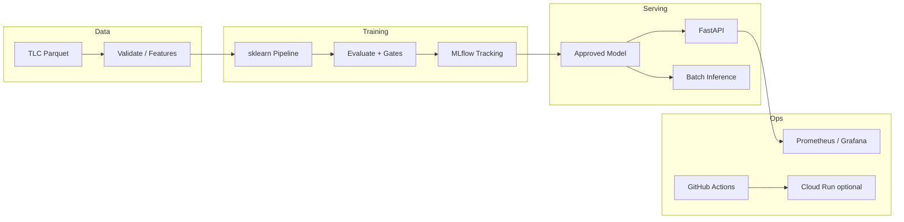

# ModelOps

Production-style **MLOps / AI infrastructure** learning platform.

ModelOps demonstrates a reusable machine-learning lifecycle: data ingestion and
validation, training and evaluation, experiment tracking, model versioning,
online and batch inference, CI/CD, monitoring, and optional Google Cloud
deployment. The first workload predicts a fare-related numerical target from
[NYC TLC yellow taxi trip records](https://www.nyc.gov/site/tlc/about/tlc-trip-record-data.page).

> **Status:** Milestone 1 (data ingestion + baseline ML) is **complete**.
> API serving, MLflow, Docker, CI, monitoring, and cloud are **not
> implemented yet**. Claims below that say “Planned” are roadmap items only.

This is a portfolio and learning project. Models trained here are **not**
authoritative real-world fare quotes.

---

## Objectives

1. Build correct, testable software you can explain in interviews.
2. Document every component so a new engineer (or future you) can operate it.
3. Prefer small, verified Git commits over large opaque dumps of code.
4. Add cloud and advanced platform features only after the local foundation works.

Target roles this project prepares for: MLOps Engineer, AI/ML Platform Engineer,
LLMOps Engineer, and Cloud Engineer working with ML workloads.

---

## Implementation status

| Area | Status | Milestone |
|------|--------|-----------|
| Repository layout, tooling, docs skeleton | **Implemented** | 0 |
| NYC taxi ingestion, validation, baseline ML | **Implemented** | 1 |
| FastAPI inference service | Planned | 2 |
| MLflow tracking and model lifecycle | Planned | 3 |
| Docker / Compose | Planned | 4 |
| GitHub Actions CI | Planned | 5 |
| Prometheus / Grafana monitoring | Planned | 6 |
| Cloud Run + Artifact Registry | Planned (approval required) | 7 |
| Terraform IaC | Planned (approval required) | 8 |
| Batch inference, drift, retrain, K8s extension | Planned | 9 |
| Portfolio / interview polish | Planned | 10 |

---

## Problem statement (initial workload)

**Goal:** Pre-trip estimate of yellow taxi **`fare_amount`** (metered fare, USD)
using pickup/drop-off TLC zones, passenger count, and pickup time — **without**
post-trip fields such as actual `trip_distance`, tips, or totals.

**Verified local baseline** (Jan 2024 sample, `max_rows=50000`, time-based holdout):

| Metric | Value |
|--------|-------|
| MAE | 5.63 USD |
| RMSE | 8.61 USD |
| R² | 0.570 |

Details, leakage rules, and limitations: [docs/DATASET_AND_MODEL.md](docs/DATASET_AND_MODEL.md).

---

## Architecture (target)



Components above the Milestone 0 package shell are **planned**. See
[docs/ARCHITECTURE.md](docs/ARCHITECTURE.md).

---

## Technology stack

| Layer | Choice | Notes |
|-------|--------|-------|
| Language | Python 3.12 | Matches `requires-python` in `pyproject.toml` |
| Packaging | setuptools + `src/` layout | Editable installs for local work |
| Lint / format | Ruff 0.11.x | Fast unified lint + format |
| Tests | pytest 8.x | Deterministic fixtures; no paid deps in CI unit tests |
| Data / ML | pandas, PyArrow, scikit-learn | Installed via `modelops[ml]` (Milestone 1+) |
| API | FastAPI, Pydantic, uvicorn | `modelops[api]` (Milestone 2+) |
| Tracking | MLflow | `modelops[tracking]` (Milestone 3+) |
| Containers | Docker / Compose | Milestone 4 |
| CI/CD | GitHub Actions | Milestone 5 |
| Cloud | GCP Cloud Run, Artifact Registry, Terraform | Milestones 7–8; **no paid resources without approval** |

Version pins and rationale live in `pyproject.toml` and
[docs/LOCAL_DEVELOPMENT.md](docs/LOCAL_DEVELOPMENT.md).

---

## Prerequisites

- macOS, Linux, or WSL
- **Python 3.12** (this repo was verified with 3.12.x)
- Git
- Optional later: Docker, Google Cloud SDK, Terraform

---

## Local setup (Milestone 0)

```bash
# From the repository root
python3.12 -m venv .venv
source .venv/bin/activate   # Windows: .venv\Scripts\activate

python -m pip install --upgrade pip
python -m pip install -e ".[dev]"

cp .env.example .env   # placeholders only; no secrets required yet
```

### Verify foundation

```bash
ruff check src tests
ruff format --check src tests
pytest
python -c "import modelops; print(modelops.__version__)"
```

Expected: lint/format clean, smoke tests pass, version `0.1.0`.

For Milestone 1 training, install ML extras:

```bash
python -m pip install -e ".[dev,ml]"
python -m modelops.data                 # download one TLC month
python -m modelops.training --download-if-missing
```

Later extras:

```bash
python -m pip install -e ".[api]"
python -m pip install -e ".[tracking]"
# or: python -m pip install -e ".[all]"
```

---

## Documentation map

| Document | Purpose |
|----------|---------|
| [docs/LEARNING_GUIDE.md](docs/LEARNING_GUIDE.md) | Beginner → intermediate MLOps walkthrough |
| [docs/DATASET_AND_MODEL.md](docs/DATASET_AND_MODEL.md) | Data, target, leakage, metrics |
| [docs/ARCHITECTURE.md](docs/ARCHITECTURE.md) | System design and trade-offs |
| [docs/API_REFERENCE.md](docs/API_REFERENCE.md) | HTTP endpoints (when implemented) |
| [docs/LOCAL_DEVELOPMENT.md](docs/LOCAL_DEVELOPMENT.md) | Day-to-day commands |
| [docs/MLFLOW_AND_MODEL_VERSIONING.md](docs/MLFLOW_AND_MODEL_VERSIONING.md) | Experiments and promotion |
| [docs/CI_CD_AND_DEPLOYMENT.md](docs/CI_CD_AND_DEPLOYMENT.md) | Pipelines and releases |
| [docs/MONITORING_AND_RELIABILITY.md](docs/MONITORING_AND_RELIABILITY.md) | Logs, metrics, drift |
| [docs/TERRAFORM_AND_CLOUD.md](docs/TERRAFORM_AND_CLOUD.md) | IaC and cost controls |
| [docs/INTERVIEW_PREPARATION.md](docs/INTERVIEW_PREPARATION.md) | Q&A and talk tracks |
| [docs/GLOSSARY.md](docs/GLOSSARY.md) | Shared vocabulary |
| [docs/ROADMAP.md](docs/ROADMAP.md) | Milestone checklist |

---

## API examples

**Not available yet** (Milestone 2). Planned endpoints include `GET /health`,
`GET /ready`, `GET /metrics`, `POST /predict`, and `GET /model-info`. See
[docs/API_REFERENCE.md](docs/API_REFERENCE.md).

---

## Testing / Docker / CI / monitoring / cloud

Documented as **planned** in the linked docs. Do not treat those sections as
verified until the corresponding milestone report says they passed locally.

**Cloud note:** No Google Cloud resources will be created without your explicit
approval. Cost and cleanup are covered in
[docs/TERRAFORM_AND_CLOUD.md](docs/TERRAFORM_AND_CLOUD.md).

---

## Security considerations (foundation)

- Secrets stay out of Git (`.env` gitignored; `.env.example` has placeholders only).
- Raw data and model binaries are gitignored.
- Later milestones will add input validation, non-root containers, and least-privilege IAM.

---

## Known limitations

- Baseline omits routed distance → accuracy is intentionally capped.
- Local training uses a row cap; not the full TLC month unless you raise `MODELOPS_MAX_ROWS`.
- No inference API, MLflow, Docker, CI, or cloud config yet.
- Model artifacts are local candidates only — not an “approved” production model.

---

## Troubleshooting (Milestone 0)

| Issue | What to check |
|-------|----------------|
| `python3` is 3.9 | Use `python3.12` explicitly |
| `ModuleNotFoundError: modelops` | Activate `.venv` and run `pip install -e ".[dev]"` |
| Ruff not found | Same editable install with `[dev]` extras |
| Accidental large files staged | Confirm `.gitignore`; never force-add `data/raw` or `models/` |

---

## License

MIT — see [LICENSE](LICENSE).
