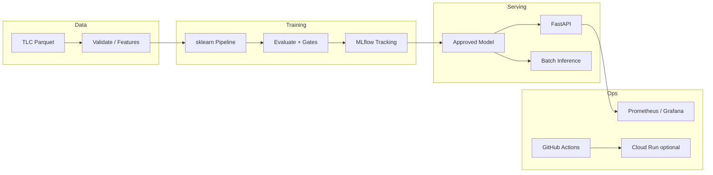

# ModelOps

Production-style **MLOps / AI infrastructure** learning platform.

ModelOps demonstrates a reusable machine-learning lifecycle: data ingestion and
validation, training and evaluation, experiment tracking, model versioning,
online and batch inference, CI/CD, monitoring, and optional Google Cloud
deployment. The first workload predicts a fare-related numerical target from
[NYC TLC yellow taxi trip records](https://www.nyc.gov/site/tlc/about/tlc-trip-record-data.page).

> **Status:** Milestones 0–9 are **Done** (local MLOps → Cloud Run CD → Terraform → batch/drift).
> Push to `main` deploys via GitHub Actions; infra under `infra/terraform/`. Tear down when demos finish.

This is a portfolio and learning project. Models trained here are **not**
authoritative real-world fare quotes.

---

## Objectives

1. Build correct, testable software you can explain in interviews.
2. Document every component so a new engineer (or future you) can operate it.
3. Prefer small, verified Git commits over large opaque dumps of code.
4. Add cloud and advanced platform features only after the local foundation works.

Target roles this project prepares for: MLOps Engineer, AI/ML Platform Engineer,
LLMOps Engineer, and Cloud Engineer working with ML workloads.

---

## Implementation status

| Area | Status | Milestone |
|------|--------|-----------|
| Repository layout, tooling, docs skeleton | **Implemented** | 0 |
| NYC taxi ingestion, validation, baseline ML | **Implemented** | 1 |
| FastAPI inference service | **Implemented** | 2 |
| MLflow tracking and model lifecycle | **Implemented** | 3 |
| Docker / Compose | **Implemented** | 4 |
| GitHub Actions CI | **Implemented** | 5 |
| Prometheus / Grafana monitoring | **Implemented** | 6 |
| Cloud Run + Artifact Registry + CD on `main` | **Implemented** | 7 |
| Terraform IaC | **Implemented** | 8 |
| Batch inference, PSI drift, delayed quality | **Implemented** | 9 |
| Portfolio / interview polish | Planned | 10 |

---

## Problem statement (initial workload)

**Goal:** Pre-trip estimate of yellow taxi **`fare_amount`** (metered fare, USD)
using pickup/drop-off TLC zones, passenger count, and pickup time — **without**
post-trip fields such as actual `trip_distance`, tips, or totals.

**Verified local baseline** (Jan 2024 sample, `max_rows=50000`, time-based holdout):

| Metric | Value |
|--------|-------|
| MAE | 5.63 USD |
| RMSE | 8.61 USD |
| R² | 0.570 |

Details, leakage rules, and limitations: [docs/DATASET_AND_MODEL.md](docs/DATASET_AND_MODEL.md).

---

## Architecture (target)



See [docs/ARCHITECTURE.md](docs/ARCHITECTURE.md) and [docs/ROADMAP.md](docs/ROADMAP.md).

---

## Technology stack

| Layer | Choice | Notes |
|-------|--------|-------|
| Language | Python 3.12 | Matches `requires-python` in `pyproject.toml` |
| Packaging | setuptools + `src/` layout | Editable installs for local work |
| Lint / format | Ruff 0.11.x | Fast unified lint + format |
| Tests | pytest 8.x | Deterministic fixtures; no paid deps in CI unit tests |
| Data / ML | pandas, PyArrow, scikit-learn | Installed via `modelops[ml]` (Milestone 1+) |
| API | FastAPI, Pydantic, uvicorn | `modelops[api]` (Milestone 2+) |
| Tracking | MLflow | `modelops[tracking]` (Milestone 3+) |
| Containers | Docker / Compose | Milestone 4 |
| CI/CD | GitHub Actions | **CI (M5)** + **CD on main (M7)** — WIF, no JSON keys |
| Cloud | GCP Cloud Run, Artifact Registry, GCS models | CD on `main` (M7); Terraform under `infra/terraform/` (M8) |

Version pins and rationale live in `pyproject.toml` and
[docs/LOCAL_DEVELOPMENT.md](docs/LOCAL_DEVELOPMENT.md).

---

## Prerequisites

- macOS, Linux, or WSL
- **Python 3.12** (this repo was verified with 3.12.x)
- Git
- Optional: Docker, Google Cloud SDK (`gcloud`) for Cloud Run deploy

---

## Local setup (Milestone 0)

```bash
# From the repository root
python3.12 -m venv .venv
source .venv/bin/activate   # Windows: .venv\Scripts\activate

python -m pip install --upgrade pip
python -m pip install -e ".[dev]"

cp .env.example .env   # placeholders only; no secrets required yet
```

### Verify foundation

```bash
ruff check src tests
ruff format --check src tests
pytest
python -c "import modelops; print(modelops.__version__)"
```

Expected: lint/format clean, smoke tests pass, version `0.1.0`.

For Milestone 1 training, install ML extras:

```bash
python -m pip install -e ".[dev,ml]"
python -m modelops.data                 # download one TLC month
python -m modelops.training --download-if-missing
```

Install tracking + API extras for the current stack:

```bash
python -m pip install -e ".[dev,ml,api,tracking]"
# or: python -m pip install -e ".[all]"
```

```bash
python -m modelops.training --download-if-missing
python -m modelops.lifecycle promote
python -m modelops.api --host 127.0.0.1 --port 8000
mlflow ui --backend-store-uri ./mlruns
```

---

## Documentation map

| Document | Purpose |
|----------|---------|
| [docs/LEARNING_GUIDE.md](docs/LEARNING_GUIDE.md) | Beginner → intermediate MLOps walkthrough |
| [docs/DATASET_AND_MODEL.md](docs/DATASET_AND_MODEL.md) | Data, target, leakage, metrics |
| [docs/ARCHITECTURE.md](docs/ARCHITECTURE.md) | System design and trade-offs |
| [docs/API_REFERENCE.md](docs/API_REFERENCE.md) | HTTP endpoints (when implemented) |
| [docs/LOCAL_DEVELOPMENT.md](docs/LOCAL_DEVELOPMENT.md) | Day-to-day commands |
| [docs/MLFLOW_AND_MODEL_VERSIONING.md](docs/MLFLOW_AND_MODEL_VERSIONING.md) | Experiments and promotion |
| [docs/CI_CD_AND_DEPLOYMENT.md](docs/CI_CD_AND_DEPLOYMENT.md) | Pipelines and releases |
| [docs/MONITORING_AND_RELIABILITY.md](docs/MONITORING_AND_RELIABILITY.md) | Logs, metrics, drift |
| [docs/TERRAFORM_AND_CLOUD.md](docs/TERRAFORM_AND_CLOUD.md) | IaC and cost controls |
| [docs/INTERVIEW_PREPARATION.md](docs/INTERVIEW_PREPARATION.md) | Q&A and talk tracks |
| [docs/GLOSSARY.md](docs/GLOSSARY.md) | Shared vocabulary |
| [docs/ROADMAP.md](docs/ROADMAP.md) | Milestone checklist |

---

## API examples

```bash
pip install -e ".[dev,ml,api]"
export MODELOPS_MODEL_PATH=models/candidates/baseline_linear_regression.joblib
python -m modelops.api --host 127.0.0.1 --port 8000
```

```bash
curl -s http://127.0.0.1:8000/health
curl -s http://127.0.0.1:8000/ready
curl -s http://127.0.0.1:8000/predict \
  -H 'Content-Type: application/json' \
  -d '{"passenger_count":1,"PULocationID":161,"DOLocationID":236,"pickup_hour":8,"pickup_dow":2,"pickup_day":15}'
```

Full schemas: [docs/API_REFERENCE.md](docs/API_REFERENCE.md).

---

## Testing / Docker / CI / monitoring / cloud

- **Tests:** `pytest` (synthetic fixture; no TLC download required)
- **Docker:** see Docker section below
- **CI:** GitHub Actions [`.github/workflows/ci.yml`](.github/workflows/ci.yml) — lint, pytest, image build (no push/deploy). Details: [docs/CI_CD_AND_DEPLOYMENT.md](docs/CI_CD_AND_DEPLOYMENT.md)
- **Monitoring:** Prometheus `/metrics` + Grafana dashboard (Compose profile `monitoring`)
- **Cloud / CD:** WIF + GCS model + push to `main` (or `./scripts/gcp_deploy.sh`). Teardown: `./scripts/gcp_teardown.sh`.
- **Terraform:** [`infra/terraform/`](infra/terraform/) — import live stack, `terraform plan` should be clean. Details: [docs/TERRAFORM_AND_CLOUD.md](docs/TERRAFORM_AND_CLOUD.md).
- **Batch / drift:** `python -m modelops.batch`, `python -m modelops.monitoring.drift`, `python -m modelops.monitoring.quality`. Details: [docs/MONITORING_AND_RELIABILITY.md](docs/MONITORING_AND_RELIABILITY.md).

**Cloud note:** Prefer free-tier / trial credits, scale-to-zero, and teardown after demos.

---

## Security considerations (foundation)

- Secrets stay out of Git (`.env` gitignored; `.env.example` has placeholders only).
- Raw data and model binaries are gitignored.
- Later milestones will add input validation, non-root containers, and least-privilege IAM.

---

## Known limitations

- Baseline omits routed distance → accuracy is intentionally capped.
- Local training uses a row cap; not the full TLC month unless you raise `MODELOPS_MAX_ROWS`.
- PRs run CI only; push to `main` deploys after CI when GitHub secrets + GCS model are set.
- Cloud Run bakes the approved model from GCS (CD) or local files (manual deploy); swap model → upload + redeploy.
- Candidate→approved promotion is local filesystem + MLflow tracking (not a remote registry server).
- Predictions are demo estimates, not official TLC quotes.

## Docker

```bash
# Needs models/approved/model.joblib (train + promote first)
docker compose build api
docker compose up -d api
./scripts/docker_smoke.sh   # optional one-shot verify
docker compose down
```

Verified locally: container `/health`, `/ready`, and `/predict` succeeded.

---

## Troubleshooting (Milestone 0)

| Issue | What to check |
|-------|----------------|
| `python3` is 3.9 | Use `python3.12` explicitly |
| `ModuleNotFoundError: modelops` | Activate `.venv` and run `pip install -e ".[dev]"` |
| Ruff not found | Same editable install with `[dev]` extras |
| Accidental large files staged | Confirm `.gitignore`; never force-add `data/raw` or `models/` |

---

## License

MIT — see [LICENSE](LICENSE).
