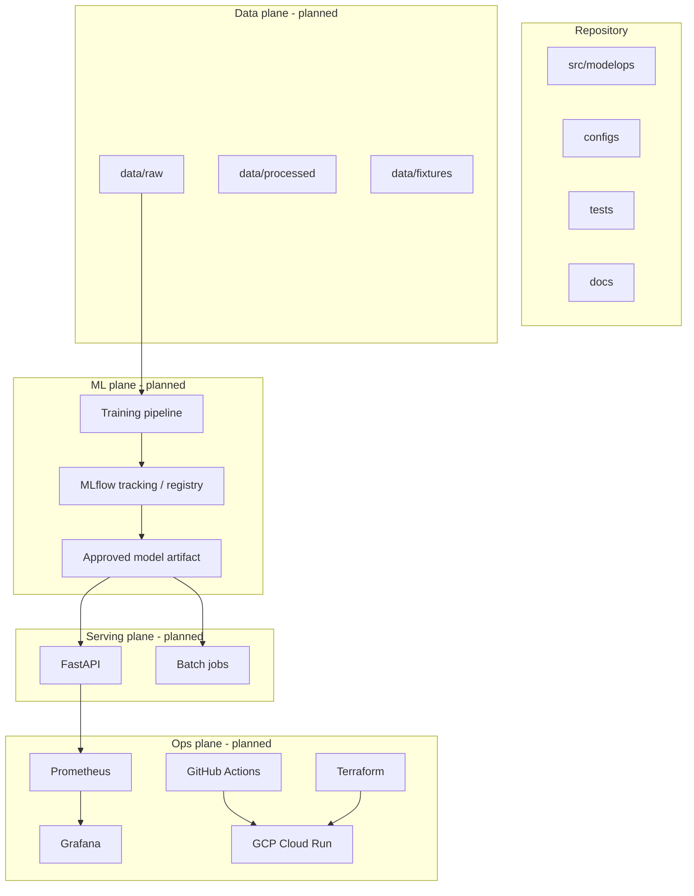

# Architecture

**Status:** Target design. Only the repository/package foundation exists today.

---

## System overview

---

## Component responsibilities (planned)

| Component | Responsibility |
|-----------|----------------|
| Ingestion | Download/load bounded TLC Parquet; record provenance |
| Validation | Schema + quality checks; fail with clear errors |
| Features | Fit transforms on train only; persist for serving parity |
| Training | sklearn Pipeline; seeds; metrics |
| Quality gates | Block promotion when thresholds fail |
| MLflow | Params, metrics, artifacts, model versions/aliases |
| FastAPI | Online predict; health/ready/metrics/model-info |
| Batch | Offline scoring over files/tables |
| CI | Lint, test, image build |
| Monitoring | Request SLIs + drift / quality signals |
| Terraform | Optional cloud resources with destroy path |

---

## Flows

### Training (Milestone 1 / 3)

1. Load raw month (or capped sample).
2. Validate and build features.
3. Time-based split.
4. Fit pipeline; evaluate; log to MLflow.
5. Run quality gate; write candidate artifact.
6. Human or scripted promotion to “approved.”

### Online inference (Milestone 2)

1. Process starts; load approved model once.
2. `/ready` fails until load succeeds.
3. `/predict` validates input, scores, returns prediction + model metadata.
4. Errors map to safe HTTP statuses without stack traces.

### Batch inference (Milestone 9)

Offline job reads a feature table, applies the same approved model, writes scores.

---

## Artifact storage

- Local: `models/`, `artifacts/`, file-backed MLflow (`mlruns/`) — all gitignored.
- Cloud (later): Artifact Registry for containers; object storage patterns as needed.

---

## Security boundaries

- Untrusted: client HTTP payloads.
- Trusted: approved model path configured by operators.
- Secrets: env / secret manager only; never in Git or images.
- Do not load arbitrary untrusted pickle from the internet.

---

## Design trade-offs

| Choice | Alternative | Why default |
|--------|-------------|-------------|
| sklearn baseline first | Deep learning day one | Explainability + faster iteration |
| File MLflow locally | Always-on tracking server | Zero infra for learning path |
| Cloud Run before GKE | Kubernetes first | Lower ops cost; K8s later as extension |
| `src/` layout | Flat package | Cleaner packaging; avoids import accidents |

## Failure scenarios (preview)

- Missing approved model → API not ready; clear log.
- Schema change in TLC feed → validation fails before train.
- Gate failure → candidate not promoted; previous approved remains.
- Cloud deploy mistake → rollback to prior revision (documented in M7).
