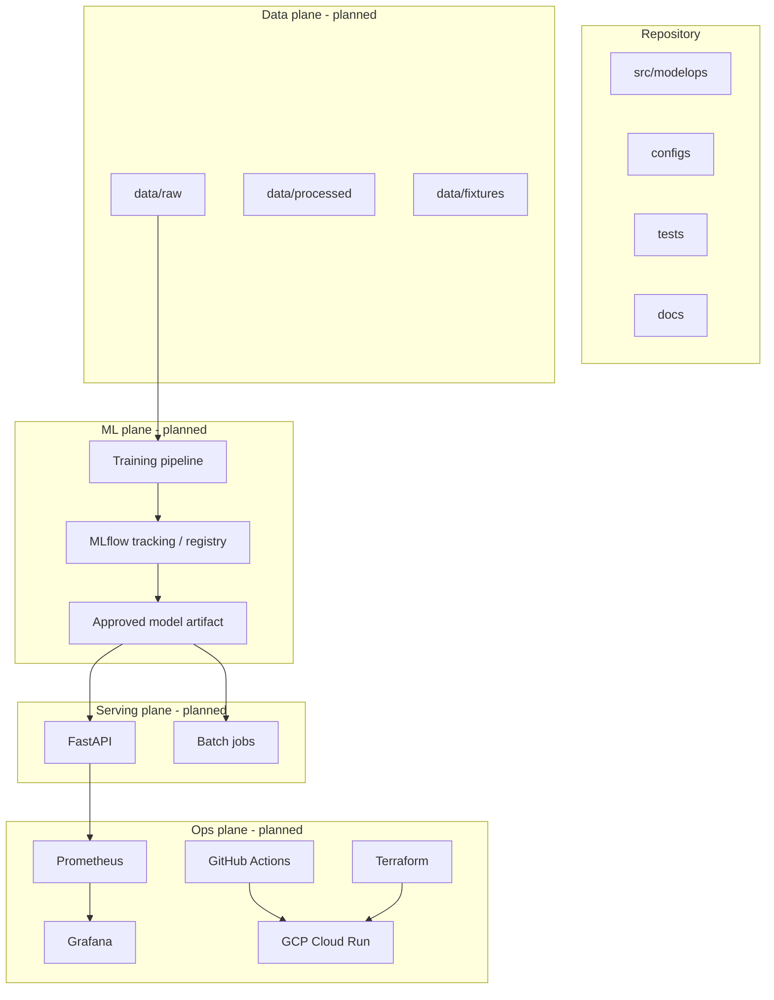

# Architecture

**Status:** Target design. **M1–M6 implemented** (through Prometheus/Grafana).
Cloud remains planned (approval required).

**Docker serving (M4):** `docker compose` builds a non-root API image and mounts
`models/approved` read-only at `/models/approved`. Training data and MLflow
stores stay off the image.

---

## System overview

---

## Component responsibilities (planned)

| Component | Responsibility |
|-----------|----------------|
| Ingestion | Download/load bounded TLC Parquet; record provenance |
| Validation | Schema + quality checks; fail with clear errors |
| Features | Fit transforms on train only; persist for serving parity |
| Training | sklearn Pipeline; seeds; metrics |
| Quality gates | Block promotion when thresholds fail |
| MLflow | Params, metrics, artifacts, model versions/aliases |
| FastAPI | Online predict; health/ready/metrics/model-info |
| Batch | Offline scoring over files/tables |
| CI | Lint, test, image build |
| Monitoring | Request SLIs + drift / quality signals |
| Terraform | Optional cloud resources with destroy path |

---

## Flows

### Training (Milestone 1 implemented; MLflow in Milestone 3)

1. Download/load raw month (or capped sample) — `python -m modelops.data`.
2. Validate and build features — `validate_and_clean` / `build_model_frame`.
3. Time-based split — `time_based_split`.
4. Fit Ridge pipeline; evaluate quality gates; write candidate joblib + metrics JSON.
5. Log params/metrics/artifacts to MLflow (`file:./mlruns`).
6. `python -m modelops.lifecycle promote` copies gated candidate → approved (+ history).

### Online inference (Milestone 2 implemented)

1. Process starts; lifespan loads configured/candidate model once (`ModelService`).
2. `/health` always OK if process up; `/ready` is `503` until load succeeds.
3. `/predict` validates with Pydantic, scores via sklearn Pipeline, returns prediction.
4. `/model-info` returns basename + safe training metadata (no absolute paths).
5. Errors map to 422/503/500 without stack traces to clients.
6. Training code is never invoked from request handlers.

### Batch inference + monitoring (Milestone 9)

1. Offline job (`python -m modelops.batch`) reads Parquet/CSV features, loads the
   same approved joblib Pipeline as the API, writes scored rows + summary JSON.
2. Training persists `reference_features.json`; promote copies it beside approved.
3. Drift job (`python -m modelops.monitoring.drift`) computes per-feature PSI vs
   that reference and fails when thresholds breach.
4. Quality job (`python -m modelops.monitoring.quality`) computes MAE/RMSE/R² when
   delayed `fare_amount` labels are present on the scored table.

---

## Artifact storage

- Local: `models/`, `artifacts/`, file-backed MLflow (`mlruns/`) — all gitignored.
- Cloud (later): Artifact Registry for containers; object storage patterns as needed.

---

## Security boundaries

- Untrusted: client HTTP payloads.
- Trusted: approved model path configured by operators.
- Secrets: env / secret manager only; never in Git or images.
- Do not load arbitrary untrusted pickle from the internet.

---

## Design trade-offs

| Choice | Alternative | Why default |
|--------|-------------|-------------|
| sklearn baseline first | Deep learning day one | Explainability + faster iteration |
| File MLflow locally | Always-on tracking server | Zero infra for learning path |
| Cloud Run before GKE | Kubernetes first | Lower ops cost; K8s later as extension |
| `src/` layout | Flat package | Cleaner packaging; avoids import accidents |

## Failure scenarios (preview)

- Missing approved model → API not ready; clear log.
- Schema change in TLC feed → validation fails before train.
- Gate failure → candidate not promoted; previous approved remains.
- Cloud deploy mistake → rollback to prior revision (documented in M7).
