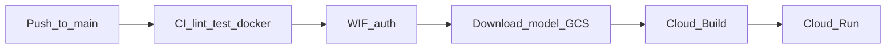

# CI/CD and deployment

**Status:** Milestone 5 CI **implemented**. Milestone 6 monitoring is **local/Compose**. Milestone 7 Cloud Run + **GitHub CD on `main`** (WIF + GCS model + Actions secrets) is **wired**; live smoke pending first merge/push to `main`.

---

## GitHub Actions — `CI` workflow

File: [`.github/workflows/ci.yml`](../.github/workflows/ci.yml)

| Trigger | Branches | Jobs |
|---------|----------|------|
| `pull_request` | → `main` | lint, test, docker |
| `push` | `main` | lint, test, docker, **deploy** |

Concurrency: one in-flight run per ref; newer pushes cancel older runs.

### Jobs

| Job | What it runs | Notes |
|-----|--------------|-------|
| `lint` | `ruff check`, `ruff format --check` | Python 3.12; pinned Ruff |
| `test` | `pip install -e ".[dev,ml,api,tracking]"` then `pytest -q` | Synthetic fixture only — **no TLC download**; covers `/metrics` |
| `docker` | Build `Dockerfile` via Buildx | **Does not push** the image |
| `deploy` | WIF → GCS model → Cloud Build → Cloud Run + smoke | **Only** on push to `main` |

Permissions: `contents: read` for CI jobs; deploy also needs `id-token: write` for Workload Identity Federation.

`prometheus-client` ships with the `api` extra. CI does **not** start Prometheus or Grafana.

### What PRs deliberately do *not* do

- Deploy to Cloud Run
- Download NYC TLC Parquet
- Require GCP credentials (deploy job skipped on PRs)

### Local equivalent (CI only)

```bash
python3.12 -m venv .venv && source .venv/bin/activate
python -m pip install -e ".[dev,ml,api,tracking]"
ruff check src tests scripts
ruff format --check src tests scripts
pytest -q
docker compose build api   # optional; needs Docker Desktop
```

Optional monitoring stack: see [MONITORING_AND_RELIABILITY.md](MONITORING_AND_RELIABILITY.md).

---

## Continuous deploy (main only)



Approved models stay **gitignored**. CD downloads them from GCS:

| Object | Path |
|--------|------|
| Model | `gs://${GCP_MODEL_BUCKET}/approved/model.joblib` |
| Metrics | `gs://${GCP_MODEL_BUCKET}/approved/model.metrics.json` |

Default bucket name from setup: `${PROJECT_ID}-models` (e.g. `modelops-platform-models`).

### One-time enable CD (run in order)

Do **not** paste `#` comments into `gcloud` commands.

```bash
export CLOUDSDK_PYTHON="$(command -v python3.12)"
gcloud auth login
gcloud config set project modelops-platform

./scripts/gcp_wif_setup.sh
```

Copy the printed values into GitHub → **Settings → Secrets and variables → Actions → Secrets**
(or `gh secret set …`):

| Secret | Example |
|--------|---------|
| `GCP_PROJECT_ID` | `modelops-platform` |
| `GCP_REGION` | `us-central1` |
| `GCP_SERVICE_ACCOUNT` | `modelops-github-deploy@….iam.gserviceaccount.com` |
| `GCP_WORKLOAD_IDENTITY_PROVIDER` | `projects/…/providers/github-provider` |
| `GCP_MODEL_BUCKET` | `modelops-platform-models` |

Upload the approved model (after local train + promote):

```bash
./scripts/gcp_upload_model.sh
```

Then push or merge to **`main`**. The **Deploy Cloud Run** job builds from [`Dockerfile.cloudrun`](../Dockerfile.cloudrun), pushes to Artifact Registry, deploys, and smokes `/health`, `/ready`, `/predict`.

Authentication uses **Workload Identity Federation** — no JSON service-account keys in GitHub.

---

## Monitoring vs deploy

| Layer | Where it lives | CI / deploy |
|-------|----------------|-------------|
| App metrics (`/metrics`) | FastAPI + `prometheus-client` | Tested in pytest |
| Prometheus + Grafana | Compose profile `monitoring` | Local only |
| Approved model | GCS `approved/` | CD downloads; local `gcp_upload_model.sh` |
| Cloud Run API | Artifact Registry image | Auto on `main`; or `./scripts/gcp_deploy.sh` |

---

## Milestone 7 — GCP Cloud Run

**Approved cost posture:** free-trial / free-tier credits; **min instances = 0**, **512Mi**, **max instances = 2**.

### What gets created

| Resource | Name / location | Purpose |
|----------|-----------------|---------|
| APIs | Run, Artifact Registry, Cloud Build, Storage, IAM | Platform services |
| GCS bucket | `${PROJECT_ID}-models` | Approved model for CD |
| Artifact Registry | `modelops` in `us-central1` | Docker images |
| Cloud Run | `modelops-api` in `us-central1` | Public HTTPS API |
| Deploy SA + WIF | `modelops-github-deploy` | GitHub Actions → GCP |

Cloud Run image **bakes** `models/approved/model.joblib`. [`.gcloudignore`](../.gcloudignore) allows the approved artifact into the Cloud Build upload even though models are gitignored.

### Manual deploy (laptop)

```bash
./scripts/gcp_deploy.sh
```

By default this also uploads the local approved model to GCS (`UPLOAD_MODEL=0` to skip). Overrides: `PROJECT_ID`, `REGION`, `SERVICE`, `MODEL_BUCKET`.

### Rollback

```bash
gcloud run services update-traffic modelops-api --region=us-central1 --to-revisions=REVISION=100
gcloud run revisions list --service=modelops-api --region=us-central1
```

### Teardown (stop charges)

```bash
./scripts/gcp_teardown.sh
# DELETE_IMAGES=1 ./scripts/gcp_teardown.sh
# DELETE_IMAGES=1 DELETE_REPO=1 ./scripts/gcp_teardown.sh
```

Set a **budget alert** in GCP Billing before leaving services up overnight. Teardown does not delete the models bucket by default (re-upload not required after every teardown).

### Image tagging

| Path | Tags |
|------|------|
| Local / CD Cloud Build | short git SHA + `latest` in Artifact Registry |

Never embed secrets in image layers. Do not commit service-account keys.

---

## Release / deploy strategy

1. Train + promote locally → `models/approved/`
2. `./scripts/gcp_upload_model.sh` (or `gcp_deploy.sh`, which uploads by default)
3. Merge / push to **`main`** → CI + CD
4. Smoke on the Cloud Run URL
5. Rollback: previous Cloud Run revision
6. Teardown when demos finish

Milestone 8 may Terraform the same resources.

---

## Secrets and variables

- CI (PRs): **no** repository secrets required.
- CD (`main`): GitHub **Actions secrets** listed above (WIF — not long-lived JSON keys).
- Prefer WIF over downloaded service-account keys.
- Grafana Compose password is for **local learning only**.
- Cloud Run is **allow-unauthenticated** for portfolio demos — tighten IAM if needed later.

---

## Branch protection (recommended)

In GitHub → Settings → Branches → rule for `main`:

1. Require a pull request before merging
2. Require status checks: `Lint (Ruff)`, `Test (pytest)`, `Docker build`
3. Do not allow force-pushes to `main`

---

## Verifying this milestone

- [x] `./scripts/gcp_wif_setup.sh` succeeded; GitHub Actions secrets set
- [x] `./scripts/gcp_upload_model.sh` uploaded `approved/` objects
- [ ] Push/merge to `main` → Deploy Cloud Run job green + smoke curls OK
- [ ] PR workflow runs lint/test/docker only (no deploy)
- [ ] `./scripts/gcp_teardown.sh` documented and tested when demos finish
