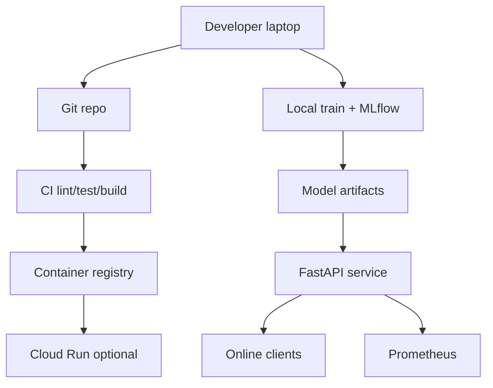

# Learning guide

**Audience:** engineers comfortable with application backends (for example Node.js)
who are learning Python, ML, and MLOps.

**Current project stage:** Milestone 2 — FastAPI serving is implemented.
MLflow lifecycle, Docker, and CI are still ahead.

---

## What is MLOps?

**Simple definition:** MLOps is the set of practices that make machine-learning
systems reliable in production: versioned data and models, automated testing,
repeatable training, controlled promotion, monitoring, and rollback.

**Why it matters:** A notebook that “got good accuracy once” is not a product.
Production fails when schemas drift, training is irreproducible, models are
deployed without gates, or nobody notices that predictions degraded.

**How this project uses it:** ModelOps walks the full lifecycle for one
defensible NYC taxi fare-related workload, then keeps the platform structure
open for additional datasets and model types later.

---

## MLOps vs traditional DevOps

| Concern | Classic DevOps app | MLOps system |
|---------|--------------------|--------------|
| Artifact | Application binary / container | App **plus** data snapshots, features, model artifacts |
| Change trigger | Code commit | Code, data, features, training config, or model |
| Quality gate | Unit/integration tests | Those **plus** data-quality and model-metric gates |
| Runtime behavior | Deterministic business logic | Statistical behavior that can silently degrade |
| Rollback | Previous app version | Previous **approved model** and/or app version |

Your NestJS / Docker / GCP skills transfer. The new ideas are **data and model
lifecycle**, leakage-aware evaluation, and monitoring prediction quality—not
only HTTP error rates.

---

## The ML lifecycle (and where ModelOps maps it)

1. **Problem framing** — What are we predicting, at what time, with what features?
2. **Data ingestion** — Repeatable download/load of a bounded TLC sample (M1).
3. **Validation** — Schema and quality checks (M1).
4. **Features** — Transforms fit on train only to avoid leakage (M1).
5. **Train** — Baseline sklearn pipeline with fixed seeds (M1).
6. **Evaluate** — MAE, RMSE, R² on a held-out / time-based split (M1).
7. **Track** — Parameters, metrics, artifacts in MLflow (M3).
8. **Gate & promote** — Candidate must beat thresholds before approval (M3).
9. **Serve** — FastAPI loads the approved model once at startup (M2).
10. **Observe** — Metrics, logs, drift checks (M6, M9).
11. **Retrain / rollback** — Documented workflows (M9).

Milestones 0–1 implement packaging plus steps 1–6 for the taxi workload. Serving
and registry come next.

---

## How every component fits (target)



**Local vs cloud (planned):** Develop and test locally with file-based MLflow and
Docker Compose. Deploy containers to Cloud Run only after approval. Kubernetes
is a later optional extension, not a day-one requirement.

---

## Why these technologies (short form)

- **Python 3.12** — Current supported line; aligns with modern scientific stack wheels.
- **pandas / PyArrow** — TLC publishes Parquet; Arrow is the right reader family.
- **scikit-learn** — Transparent baselines; pipelines encode preprocessing + model.
- **MLflow** — De-facto open experiment + model registry for portfolio systems.
- **FastAPI / Pydantic** — Typed request validation and OpenAPI for serving.
- **pytest / Ruff** — Fast feedback without a heavyweight toolchain.
- **Docker / Compose** — Same artifact shape locally and in CI/cloud.
- **Prometheus / Grafana** — Standard SRE metrics path.
- **Terraform + GCP** — Declarative infra with explicit cost boundaries.

---

## What Milestone 1 taught (read the code)

| Module | Role |
|--------|------|
| `modelops.data.download` | Repeatable TLC fetch with provenance fields |
| `modelops.data.load` | Parquet + `max_rows` cap |
| `modelops.data.validate` | Explicit drop reasons (no silent fabrication) |
| `modelops.data.features` | Pre-trip feature set; leakage denylist |
| `modelops.data.split` | Chronological train/eval cut |
| `modelops.training.pipeline` | Ridge + OHE zones (why not plain OLS) |
| `modelops.training.train` | Orchestrates fit, metrics JSON, candidate artifact |

### Mini mental model: prediction time

```text
Pre-trip estimate:  only info known before the trip starts
Completed-trip audit: measurements known after completion (distance, tips, …)

Mixing the two without documenting it = interview red flag.
```

### What Milestone 2 taught

| Piece | Role |
|-------|------|
| `modelops.api.model_service` | Load once; predict; ready flag |
| `modelops.api.schemas` | Request ranges aligned with training filters |
| `modelops.api.routes` | `/health` `/ready` `/predict` `/model-info` |
| `modelops.api.app` | Lifespan load; safe error handlers |

### What to learn before Milestone 3

1. MLflow experiments, runs, and artifacts.
2. Candidate vs approved / registry aliases.
3. Quality gates before promotion.
4. How serving should pin an approved alias, not “whatever was last trained.”

---

## Common mistakes

- Committing raw Parquet or `.pkl` models to Git.
- Using `trip_distance` in a “pre-trip” model without calling it a routing estimate.
- Random train/test splits on time-ordered trip data without justification.
- Treating the learning baseline as a production fare quote.

## Production considerations

- Pin versions; record dataset month and download provenance.
- Fail closed when the approved model is missing.
- Keep secrets out of images and logs.

## Interview questions (warm-up)

1. What is the difference between `/health` and `/ready`? *(Answer after M2.)*
2. Why separate training code from the prediction request path?
3. What would you put in `.gitignore` for an ML repo, and why?

More questions: [INTERVIEW_PREPARATION.md](INTERVIEW_PREPARATION.md).
